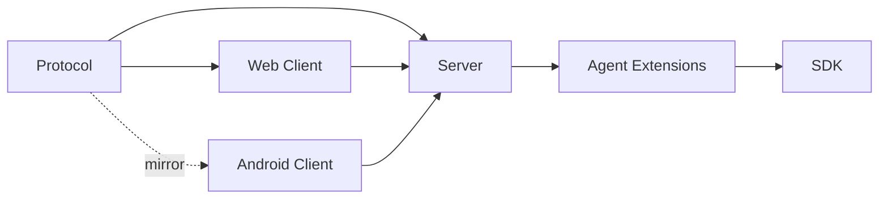
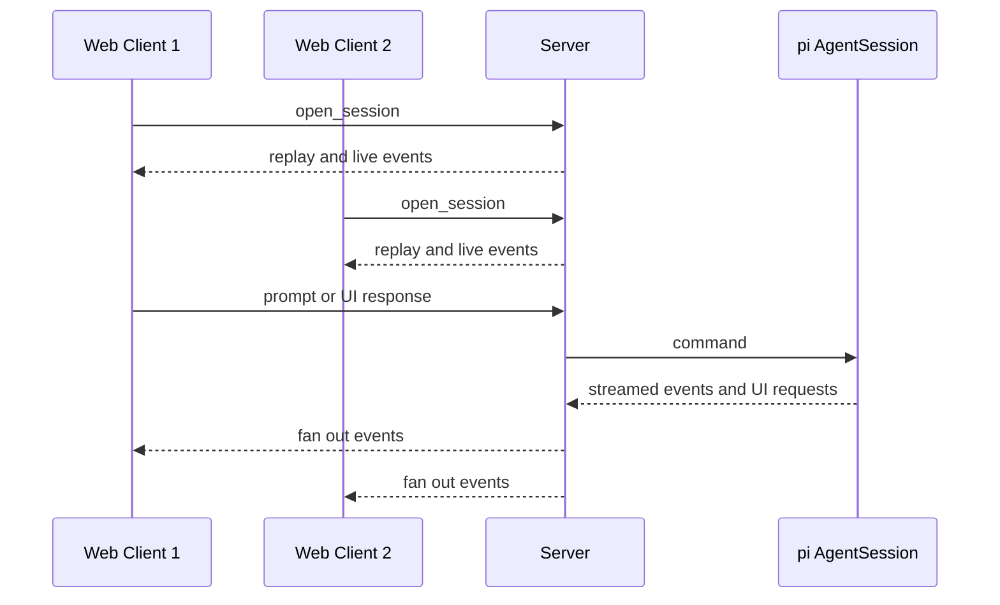

# Codemap

## Overview

Pimote is a Node.js server and SvelteKit PWA for using pi coding-agent sessions remotely. Server and web client share a TypeScript WebSocket protocol; an independent Kotlin Android client mirrors the subset it consumes. Pi extensions provide voice calls, static hosting, file downloads, and panel cards.

### Key Flows

## Modules

### Protocol

Defines the TypeScript WebSocket contract shared by server and web client.

**Responsibilities:** wire commands and events, request/response envelopes, session and message data, observer/archive lifecycle vocabulary (`open_session` error `session_archived`, `session_archived` event, `archived` close reason), ownership hard-cut (`isOwnedByMe`, open `force`, `session_owned`, session `displaced`, and `remoteSessions` removed), `extension_ui_resolved` and `session_settings_changed`, native bash metadata, panels and downloads, voice call vocabulary, provider login steps, tree navigation, update availability, folder discovery and curation vocabulary (windowed listings, order tokens, epochs, delta syncs, FolderInfo rows with hub members)

**Dependencies:** none; Android maintains a hand-written mirror of the subset it consumes

**Files:**

- `shared/src/**`

### Server

Hosts pi `AgentSession` instances and exposes the HTTP and WebSocket API.

**Responsibilities:** CLI and configuration (roots, managerRoot, tagSnippets, VAPID), HTTP and PWA serving, WebSocket command routing and envelopes, AgentSession slots with replay buffers and per-client observers, cursor-aware event fan-out and observer attach/detach, session open/archive/close lifecycle and archived-open rejection, observer-aware idle reaping and folder-scoped external-process conflict checks, voice-call-holder-aware reaping, `call_bind` auto-reopen of dormant record-backed sessions (holder, not observer), SDK-to-wire event mapping, file edit and file get/put service (tilde expansion, atomic symlink-preserving writes), `fd`-backed file-reference autocomplete, session records, summaries, metadata, and lifetime cost, sparse folder-model discovery (marker-aware code/persona classification, visit budget with partial-tree fallback), repo index over the folder model (TTL caches, stale-while-revalidate, bounded git-status probes), folder listing (windows, monotonic epochs, reconciled deltas, two-tier search, hub symlink-inventory members), curated folder registry (favorites, archive state, tags), hub materialization and membership edits over the on-disk symlink inventory and managed AGENTS.md blocks (shape, not creator ownership), shared folder seeding (`folder-seeding.ts` renderers for code and persona AGENTS.md plus persona memory stub), jiti-loaded user folder sources, shared code-folder creation routing (`folder-create.ts`, wire and manager alike), manager extension lifecycle and its seven-tool folder/persona/session surface (kind-parameterized creation, curation, batched hub membership; filtered-first reads — find_folders/find_sessions with query (two-tier), nature, hub, includeArchived, no freshness flag or limit — DR-062 revised by DR-074; 16KB spill guard over the find tools' rows into JSONL files the agent greps/jqs — DR-071; turn-abort signal raced against the shared discovery walk and session cache fills — DR-072) plus the `pimote-docs` system-prompt section (`server/src/pimote-docs/`), provider OAuth login orchestration, web push, TTL-cached npm update checks, shared utilities (paths, branding, version, tool-result idiom — DR-073, `sdk-twins` Protocol/SDK parity assertions)

Client auth is external (Cloudflare Access); the server implements no auth.

**Dependencies:** Protocol for wire types; Agent Extensions for session tools and resources; `@pimote/sdk` for the folder-sources seam types and the activity reap-guard value import (`askActivity`)

**Files:**

- `server/src/*.ts`
- `server/src/folder-model/**`
- `server/src/manager/**`
- `server/src/folder-sources/**`

### Agent Extensions

In-process pi extensions for voice calls, static bundles, and one-shot file downloads.

**Responsibilities:** voice call state machine (pure reducer with lifecycle/streaming/walkback sub-machines plus imperative shell), speechmux WebSocket bridge and call-bind dispatch, single call holder per session with targeted forced-transfer notification, FIFO utterance queue with settlement-aware interruption, identity-based walk-back context rewrite, interpreter prompt riding a named pi prompt section, static-host registry, store, HTTP handler, tools, and static-report guidance listed in the `pimote-docs` section, file-download offer registry and HTTP tools, panel and EventBus integration

`voice-orchestrator.ts`/`voice-orchestrator-boot.ts` and `session-json-store.ts` sit under the Server glob but serve this module.

**Dependencies:** Server for lifecycle, routes, and session EventBus; Protocol for client events; SDK panels for static-host cards; pi SDK extension APIs

**Files:**

- `server/src/voice/**`
- `server/src/voice-orchestrator.ts`
- `server/src/voice-orchestrator-boot.ts`
- `server/src/static-host/**`
- `server/src/pimote-docs/**`
- `server/src/file-download/**`
- `server/src/session-json-store.ts` (shared persistence seam)

### Web Client

Installable SvelteKit PWA for browsing, controlling, and rendering remote pi sessions.

**Responsibilities:** WebSocket reconnect and request/response, multi-observer session registry with URL-synced navigation, archived-session restore cleanup while retaining tracked transcripts, streamed conversation and tool rendering, observer-local settings updates, composer bang-command parsing with dedicated bash execution UI, explicit abort with draft restore, manager input as a toolbar box (search/manager toggle, prior-manager-session dropdown) submitting over ordinary persisted sessions, single-column dashboard landing with desktop Continue cards, windowed virtualized folder list (TanStack variable-height rows, epoch-guarded delta sync, server-authoritative debounced search, live subset re-sort), four-kind folder-creation wizard (code/persona folders and hubs, member selection, seeded instructions), hub create and member management, favorites and archive/restore, folder-scoped config-file editor (AGENTS.md load/save, tag snippets) and agent-initiated editor requests sharing one fullscreen dialog shell (`CodeEditorDialog`: mobile header save/close, lazy-loaded CodeMirror with retry-on-reopen failure state), composer `@`-file autocomplete, extension dialogs with cross-observer resolution and panels, downloads inbox and push, browser voice calls with TTS, provider login, update banner and ambient status, PWA service worker

**Dependencies:** Protocol for wire types; Server's HTTP/WebSocket API

**Files:**

- `client/src/**` (notably `lib/components/Dashboard.svelte`, `lib/components/FolderList.svelte`, `lib/components/HomeToolbar.svelte`, `lib/components/BashExecution.svelte`, `lib/stores/folder-store.svelte.ts`, `lib/stores/connection.svelte.ts`, `lib/stores/session-registry.svelte.ts`, `lib/session-route.ts`, `lib/bash-command.ts`, `lib/manager-composer.ts`)

### SDK

Published `@pimote/sdk` extensibility package that pi extensions import to talk to pimote.

**Responsibilities:** card types, EventBus panel detection, namespace-scoped panel handles, background-activity reap-guard seam (`@pimote/sdk/activity`: synchronous EventBus poll with `answerActivity`/`askActivity` twins, consumed by the server's idle reaper — DR-054), folder discovery and creation seam types (`@pimote/sdk/folders`, awaited `onFolderOpen`), RepoInfo twin of the wire type

The server's `sdk-twins.ts` asserts compile-time equality between SDK and Protocol types.

The npm package is the authoring surface for extension developers. The app bundles its own copies (`bundleDependencies`) of the SDK and pinned pi runtime, so the packed install never resolves them from the consumer's tree. The server's folder-source loader pins user-module `@pimote/sdk` imports to that bundled copy.

**Dependencies:** pi SDK extension APIs

**Files:**

- `packages/sdk/src/**`

### Android Client

Native Kotlin voice-first peer that connects to Pimote through Android's calling surfaces.

**Responsibilities:** WebSocket/session synchronization, self-managed Telecom calls, WebRTC audio, contacts sync, Assistant shortcuts, Android Auto car UI, Compose UI, settings and authentication

**Dependencies:** Server's WebSocket API; Protocol mirror (hard-cut removes session ownership fields, `open_session.force`, and session-level `displaced`, and adds archived-session close vocabulary; Android must update in lockstep; windowed `list_folders` and `folders_changed` also have no compatibility shim; push metadata `projectName` is deliberate wire vocabulary); Android Telecom, Contacts, Car App, and WebRTC APIs

**Files:**

- `mobile/android/**`

### Development Tooling

Packages, boots, tests, and manually exercises the product surfaces.

**Responsibilities:** npm CLI entry, install/service/patch setup scripts, session archival and voice diagnostics, permanent manual-test plan (`tools/manual-test/PLAN.md`, journeys 12–13) and driver catalog (`tools/manual-test/README.md`), two-observer smoke (`tools/manual-test/session-observers-smoke/session-observers-smoke.mjs`: transcript/send fan-out, dialog resolution, archive/restore, voice holder, and external-process conflict), end-to-end dashboard/folders/hubs smoke against a fabricated multi-root tree (wizard creation, member management, archive/restore; session-surface polling with mount-latency logging and client-state timeout dumps), manager-tool and manager-lifecycle probes, windowed folder-paging smoke over a ~250-row fixture, journey smokes (AGENTS.md editor, `@`-file syntax, cost accumulation, streaming code highlight, static host/PWA, downloads, provider login), deterministic update-notification harness, shared smoke harness lib (report, sandbox, ws-probe, browser driver, session-dir fixtures), extension UI test fixture, release/publish CI and Docker-based Android build targets

**Dependencies:** Server, Web Client, Agent Extensions, and Android Client as applicable

**Files:**

- `bin/**`
- `scripts/**`
- `tools/**`
- `.pi/**`
- `Makefile`
- `patches/**`
- `.github/workflows/**`
- `.husky/**`
- `package.json`
