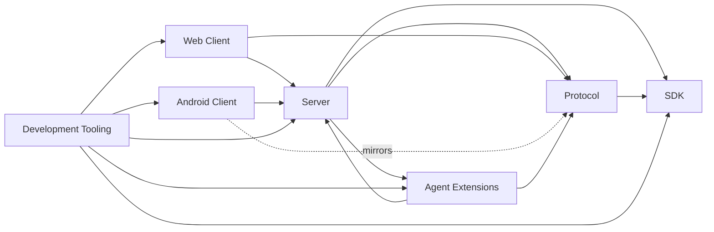
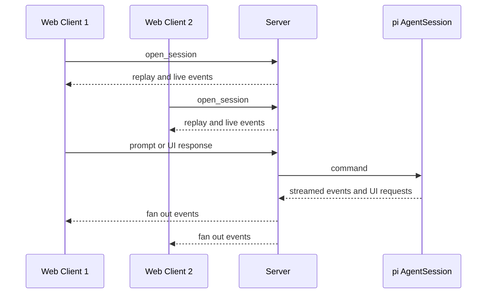

# Codemap

## Overview

Pimote is a Node.js server and SvelteKit PWA for remote pi sessions, with a Kotlin Android client for voice-first use. The server embeds pi `AgentSession`s and serves both clients over WebSocket. `shared/` defines the TypeScript wire protocol; extensions use `@pimote/sdk`.

### Key Flows

## Modules

### Protocol

Defines the TypeScript wire contract for the server and web client, including the PWA theme catalog and selection protocol.

**Responsibilities:** commands and typed responses, session and folder contracts, lifecycle and live events, replay and resync envelopes, transcript, usage and image data, subagent views, extension UI, panels and downloads, voice, login, push, settings and update vocabulary, theme definitions, the design token fallback graph and resolved catalogs, catalog revision events and profile selection

**Dependencies:** SDK for canonical subagent, panel and folder types. Android mirrors its consumed wire subset by hand and skips unknown event types.

**Files:**

- `shared/src/**`

### Server

Hosts pi `AgentSession` instances and exposes the HTTP and WebSocket API, including theme catalog and preference services.

**Responsibilities:** CLI and startup, validated runtime configuration, Pimote extension host and Settings catalog, HTTP/PWA and WebSocket APIs, pi session lifecycle and wire projection, observer delivery and replay/resync, subagent views, folder discovery/indexing/listing/curation, guarded hub/worktree management, manager tools, session records and metadata, image/file delivery, provider login, web push and update checks, built-in/extension/user theme catalog validation and resolution, token graph resolution, theme source watching and revision notifications, theme normalization tooling, live default configuration and per-user theme persistence

The server has no client-auth layer; deployment supplies access control.

**Dependencies:** Protocol for wire types, SDK for folder and extension contracts, Agent Extensions for per-session features

**Files:**

- `server/src/*.ts`
- `server/src/folder-model/**`
- `server/src/manager/**`
- `server/src/folder-sources/**`
- `server/src/pimote-extensions/**`

### Agent Extensions

Pi session and process-global extensions for voice, static hosting, one-shot downloads and registered theme files.

**Responsibilities:** voice-call orchestration and speech bridge, static-host publishing, durable global Apps catalog and Caddy reconciliation, file-download offers, extension prompts, panel and EventBus integration, ordered theme-file registration through the global extension host

The server-root voice orchestrator and shared JSON store bridge these extensions to server lifecycle and persistence.

**Dependencies:** Server for session lifecycle, EventBus and HTTP integration, Protocol for wire payloads, pi SDK extension APIs

**Files:**

- `server/src/voice/**`
- `server/src/voice-orchestrator.ts`
- `server/src/voice-orchestrator-boot.ts`
- `server/src/static-host/**`
- `server/src/apps/**`
- `server/src/pimote-docs/**`
- `server/src/file-download/**`
- `server/src/session-json-store.ts`

### Web Client

Installable SvelteKit PWA for browsing, controlling and rendering remote pi sessions.

**Responsibilities:** WebSocket connection and session registry, transcript streaming and resync, root and child views, composer and command dispatch, dashboard and manager workflows, settings and file editors, conversation and tree navigation, cost and usage views, extension UI and panels, voice calls, downloads and push, provider login, PWA updates and offline behavior, paired UI/editor/terminal palettes, Appearance preview/save/cancel and user-scoped theme cache, early theme bootstrap and static-report bridge

**Dependencies:** Protocol for wire types, Server's HTTP and WebSocket API

**Files:**

- `client/src/**`

### SDK

Published `@pimote/sdk` package for session and process-global extensions.

**Responsibilities:** panel card types and handles, background-activity polling, subagent provider/topology/lease contracts, folder-source types, process-global Pimote extension context, `context.themes.registerFile` contract for packaged theme JSON

**Dependencies:** pi coding-agent SDK types

**Files:**

- `packages/sdk/src/**`

### Android Client

Native Kotlin client for voice-first access and Android Auto.

**Responsibilities:** WebSocket session and folder sync, Telecom/WebRTC calls, Contacts and Assistant integration, Android Auto UI, authentication, settings and Compose screens

**Dependencies:** Server's WebSocket API and the consumed Protocol subset mirrored by hand, Android Telecom, Contacts, Car App and WebRTC APIs

**Files:**

- `mobile/android/**`

### Development Tooling

Builds, packages, tests, installs and manually exercises Pimote's npm and Android workspaces.

**Responsibilities:** npm build/package/release and dependency-patch workflows, install and service scripts, test configuration, manual browser/API smoke drivers including the client-themes Appearance and static-report bridge smoke, Docker-based Android builds and device tools

**Dependencies:** Server, Web Client, Agent Extensions, SDK and Android Client

**Files:**

- `bin/**`
- `scripts/**`
- `tools/**`
- `.pi/**`
- `.github/workflows/**`
- `.husky/**`
- `patches/**`
- `client/*.config.{js,ts}`
- `eslint.config.js`
- `Makefile`
- `package.json`
- `server/vitest.config.ts`
- `server/test-setup.ts`
